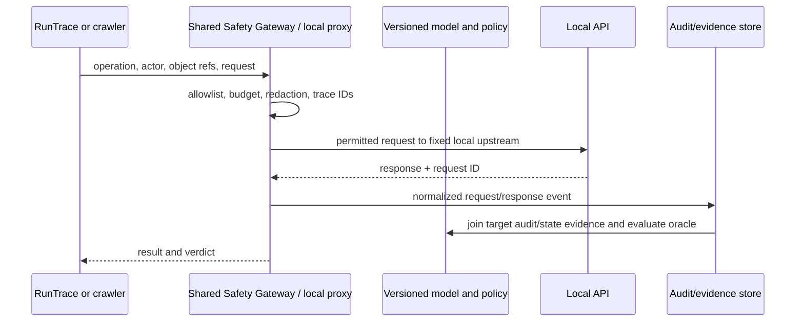
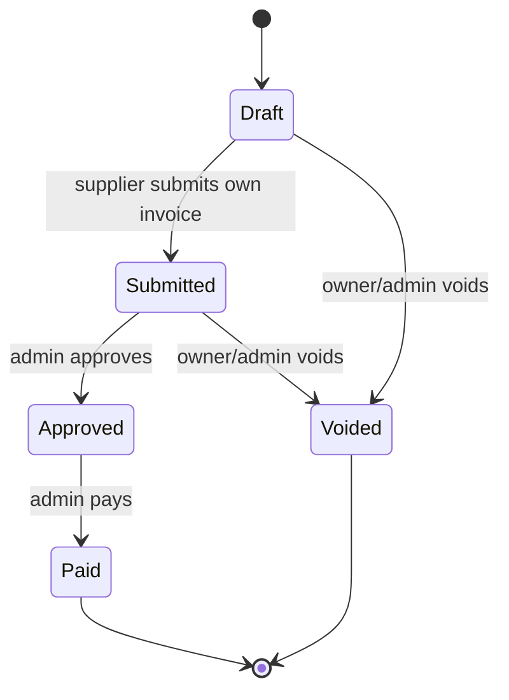

# Stateful API business-logic testing plan

## Purpose

The system should determine whether an API operation is correct for the
current actor, object, and business state. It should not infer correctness from
an HTTP status alone. The normative oracle is the app's access policy, property
policy, state graph, and invariants; OpenAPI and observed traffic provide
structure and examples, but do not define authorization or business rules by
themselves.

## Inputs and their authority

| Input | What it tells the system | What it must not be treated as |
|---|---|---|
| OpenAPI | Methods, route templates, parameter/body/response types, authentication declarations | Complete role policy or business-state truth |
| RunTrace and an explicit local traffic proxy | Requests/responses that occurred, actor/session, identifiers produced and consumed, timing and state evidence | Proof that every observed call is allowed for every actor or every state |
| State-aware crawler | Reachable routes and UI/API actions from a particular actor and state | An oracle for whether a route or transition is correct |
| App policy and business state graph | Intended allow/deny rules, property access, transition preconditions/postconditions and invariants | An implementation detail copied from the target without review |
| Ground truth | Frozen planted and benign cases used for evaluation | Planner input for held-out evaluation cases |

When observed behavior conflicts with the declared policy or graph, record a
candidate discrepancy for review. Do not silently change the policy to match
the implementation or a trace. Confirm ambiguous business rules with the app
owner, then version the model before evaluating the detector.

## System model

Represent each operation as a typed action:

```yaml
id: approve_invoice
http: {method: POST, path: /lab/v1/invoices/{invoice_id}/approve}
consumes: [{name: invoice_id, type: invoice, source: prior_response.ID}]
actor_policy: {roles: [Admin], tenant_relation: same_tenant_or_platform}
preconditions: [{object: invoice, field: Status, in: [submitted]}]
postconditions: [{object: invoice, field: Status, equals: approved}]
effects: [invoice_status_change, audit_event]
```

The complete test context is `actor + session + tenant + object graph + current
state + prior sequence outputs`. Model object IDs as typed producer/consumer
values, not arbitrary strings. For example, an invoice creation response
produces an `invoice_id`; submit consumes it; approve consumes the same ID
after checking the resulting state.

## Proxy: concrete role and operating procedure

For this project, treat the proxy as an **application-layer HTTP capture and
safety boundary**, not a raw packet sniffer. Packet capture cannot reliably
associate an HTTPS request with the test actor or decoded operation without
TLS termination, and it does not provide the business context needed by the
oracle.

Use one shared gateway implementation with an app-specific runtime profile. The
custom profile binds the listener to loopback (`127.0.0.1:8088`) and fixes the
upstream to the local custom API (`localhost:8000`). RunTrace and later crawler
clients send HTTP through that listener. The gateway safety allowlist controls
which requests may be forwarded; `access_policy.yaml`, the state graph, and
ground truth are independent oracle/model inputs and must not block a probe
before the target receives it.

Each app gets its own profile containing the upstream, allowlist, synthetic
actor registry, event destination, and references to the app's policy/state
model. This keeps one gateway implementation while isolating app targets and
rules. The profile selects a fixed upstream; callers cannot supply a
destination URL. Keep the listener on loopback and use synthetic accounts only.



### One request through the boundary

1. Start a run with immutable `model_version`, `policy_version`, `seed_id`,
   `run_id`, `workflow_id`, and `sequence_id`. Assign a monotonically increasing
   `step_idx`, including sign-in requests.
2. Resolve the request to exactly one method/path operation. Attach the known
   actor ID and typed object IDs from earlier responses; never derive an actor
   identity from an untrusted client header alone.
3. Check local host/port, method/path allowlist, per-run request budget,
   concurrency/rate budget, and any manual-approval gate. Default-deny when the
   operation is unknown or the target is not the local range.
4. Validate request syntax/schema and preconditions. Set `valid_request` in the
   harness record: a valid authorization-denied request can be `true`; a
   malformed request, nonexistent object, or unmet state precondition is
   `false` under the project's definition.
5. Record a redacted request and canonical fingerprint, then forward it. Keep
   credentials in memory only. Redact auth/cookie headers, password/OTP/token
   fields, payment secrets, and policy-defined sensitive response properties
   before writing evidence. For file or streaming bodies, record media type,
   size, and hash rather than file contents.
6. Capture status, selected response fields, elapsed time, request ID, and
   response hash. For a state-changing operation, obtain before/after state
   from the local audit/state adapter or deterministic readback. Do not claim
   that a `2xx` proves the requested state change was correct.
7. Evaluate the family-specific oracle against the **normative** policy/graph
   version. Store the verdict and evidence; an observed but unexplained edge is
   a candidate for model review, never an automatic policy update.

For RunTrace, the practical route is:

```text
trace JSON -> DSLExecutor -> gateway client -> 127.0.0.1:8088 -> localhost:8000
```

Start the target API first, then from `lab-apps/custom/app` start the proxy with
`python gateway.py --serve --profile gateway_profile.json`; run a trace with
`python runtrace.py --proxy-url http://127.0.0.1:8088 --scenario cyber-range/traces/probes/trace_01_access_boundaries.json`.
The profile points to the safety allowlist, RSO actor registry, event JSONL,
and app model references. The listener enforces local-only clients, exact
method/path allowlisting, approval gates, request budgets, concurrency/rate
bounds, and redaction. The target audit log remains the source for authoritative
before/after state evidence; proxy events correlate through `x-request-id` and
do not claim to contain state snapshots. A browser crawler should use this same
local boundary or the same gateway engine through a dedicated adapter.

### Event record to persist

Use one event per HTTP request, including token issuance. The event should
contain at least:

```json
{
  "run_id": "run-...", "workflow_id": "workflow-invoice-payment",
  "sequence_id": "seq-...", "step_idx": 3, "seed_id": "seed-v8",
  "model_version": "custom-rso-v1", "actor_id": "actor-supplier-a",
  "operation_id": "submit_invoice", "object_refs": {"invoice_id": "invoice-a-001"},
  "valid_request": true, "request_redacted": {}, "response_redacted": {},
  "status": 200, "elapsed_ms": 12.4, "case_id": null,
  "before_state": {"Status": "draft"}, "after_state": {"Status": "submitted"},
  "request_fingerprint_sha256": "...", "response_sha256": "...",
  "timestamp": "...", "gateway_verdict": "allowed", "oracle_verdict": "pass"
}
```

Name hashes by their exact meaning. A raw-body hash, a canonical
method/path/query/header/body fingerprint, and a response-body hash are three
different values. The current app audit hash covers the raw request body;
`SafetyGateway` computes a canonical request fingerprint. Do not label either
one simply `raw_hash` in the export unless the export preserves that
definition. Keep raw credentials and raw response bodies out of the event
store.

## Minimum model required by the system

The oracle cannot decide business correctness from OpenAPI alone. Build a
versioned model with these connected parts:

| Model part | Minimum fields | Primary source |
|---|---|---|
| API operation | Stable ID, method, route template, params/body/response schemas, auth requirement, produces/consumes | OpenAPI plus observed traffic |
| Actor/session | Actor ID, role, tenant, scopes, active status, synthetic credential reference (never token value) | RSO/seed and auth setup |
| Resource/object | Type, stable ID, owner, tenant, state fields, parent/child references, seed provenance | Seed, API responses, state adapter |
| Access policy | Operation, allow/deny roles, actor-object relation, tenant relation, field read/write sets | Reviewed app policy |
| State machine | Entity type, state field, states, transition operation, source states, actor guard, preconditions, postconditions, effects | Reviewed business workflow and implementation |
| Invariant | Predicate over one or more objects/events, scope, terminal/idempotency rules, expected safe failure | Business owner and threat model |
| Dependency graph | Response field/type produced by one operation and consumed by another | OpenAPI links, RunTrace, crawler |
| Test environment | Seed/reset ID, flag set, API build, model/policy versions, allowed host and safety budgets | Range configuration |

Do not encode session tokens as model data. The model stores actor/session
identity and required auth state; the gateway obtains and holds the actual
token only while executing the run.

### Operation and transition record templates

```yaml
operation:
  id: submit_invoice
  http: {method: POST, path: /lab/v1/invoices/{invoice_id}/submit}
  parameters:
    path: {invoice_id: {type: invoice.id, required: true}}
  auth: {required: true}
  produces: [{name: invoice.Status, type: enum}]
  consumes: [{name: invoice_id, type: invoice.id, source: seed_or_prior_response}]

transition:
  id: INVOICE-T01
  entity: invoice
  operation_id: submit_invoice
  from: [draft]
  to: submitted
  actor: {roles: [Supplier, Admin], relation: [owner, privileged]}
  preconditions: [same_tenant, invoice_exists]
  postconditions: [status_is_submitted]
  effects: [append_audit_event]
  failure: {safe_status: [403, 404, 409], state_unchanged: true}
```

### Graph structure and construction

Do not create one giant graph node for every actor × object × state
combination. Keep typed subgraphs and join them at execution time:

1. **Operation graph:** operations are nodes; typed `produces -> consumes`
   edges connect IDs and values across requests.
2. **Object graph:** object nodes carry owner/tenant/parent relationships and
   current state. This supports F1/F4 and list-contents checks.
3. **State graph:** each entity type has state nodes and guarded transition
   edges. Attach operation ID, actor guard, preconditions, effects, and
   postconditions to each edge.
4. **Policy graph/matrix:** operation × role × object relation × tenant
   relation × property policy resolves to allow, deny, or explicitly unknown.
5. **Invariant set:** predicates span graph state, such as `paid_is_terminal`,
   `refund_at_most_once`, or `tenant_id_unchanged_by_customer_patch`.

Keep `unknown` separate from `deny`. If the model has no rule for an operation,
the planner should pause that operation for review or run only a safe
observation; it must not invent a rule from one successful trace. Add source
and confidence metadata to each inferred candidate rule, then require human
confirmation before promoting it to normative policy.

## State-aware crawl procedure

Run the crawler as a bounded graph explorer, not a link-following spider:

1. Start from a named seed snapshot and one actor session. Record the initial
   object graph and state hash.
2. Enumerate only operations reachable by that actor under known policy and
   allowlist. Add OpenAPI routes, UI-discovered routes, and routes in observed
   traces to the candidate inventory; deduplicate by method + route template.
3. For each operation, resolve required path/query/body values from typed seed
   objects or prior response producers. Check operation preconditions before
   sending.
4. Execute read-only candidates first. For a mutating operation, fork/reset
   the seed, execute one action, record effects, then read back state and
   update the **observed** graph.
5. Compare discovered operation/state pairs with the normative model. Missing
   routes/edges become coverage gaps; unexpected success, field change,
   cross-tenant result, or transition becomes an oracle candidate with the
   exact rule that failed.
6. Use bounded breadth-first expansion by depth, request count, and state
   count. Stop a branch on unknown policy, failed precondition, safety-gateway
   denial, unexpected side effect, or failed reset verification.

Each crawl state key should include at least actor ID, tenant, resource type/ID,
state fields, and seed version. Normalize volatile IDs only after preserving
the real ID in the evidence record so producer-consumer provenance remains
replayable.

The business graph has typed object-state nodes and guarded edges. Each edge
records the action, allowed actor/ownership relation, required state, other
preconditions, expected state change, and side effects. Invariants apply across
edges—for example, a paid invoice cannot be paid again and a released payout
cannot return to `approved`.



Maintain two related graphs:

1. **Observed graph**: edges seen in RunTrace, proxy capture, or crawler runs,
   each labeled with actor, seed, response, and provenance.
2. **Normative graph**: reviewed transitions and authorization rules used by
   the test oracle.

An observed edge can suggest a missing normative edge, but cannot add one
automatically. Keep graph versions and the source of each rule so a test result
can be reproduced.

## Capture, crawl, and sequence generation

1. Import the OpenAPI document and normalize each method/path into one operation
   ID. Resolve path-level and operation-level security, parameters, request
   schemas, response schemas, and links.
2. Run safe baseline workflows through RunTrace. If a proxy is used, bind it
   only to the local Cyber Range, mark each run with a run/workflow/sequence ID,
   and redact credentials and sensitive fields before writing evidence.
3. Crawl with one seeded actor at a time. Track the actor's session and current
   state; follow only discovered same-origin links and allowlisted operations.
   After each state-changing action, read back the object or use the app audit
   snapshot to update the observed graph.
4. Build producer-consumer links from response IDs to later path/body/query
   parameters. Reject a generated sequence when an ID is missing, the object
   type is wrong, or a required precondition is not met.
5. Generate three classes of sequence: valid business baselines, differential
   authorization probes, and state-invariant probes. Keep a denied
   authorization probe inside an otherwise valid sequence only when its
   request is syntactically valid and its object/state preconditions hold.
   Test an intentionally invalid state edge in a separate sequence and mark
   that request `valid_request=false` under the project's valid-request rule.
6. Reset to a known seed between stateful runs. Use a disposable database when
   reset also recreates base application collections. Do not run mutable
   sequences concurrently against a shared seed.

The proxy should emit a normalized event, not a raw packet dump:

```json
{
  "run_id": "...", "workflow_id": "...", "sequence_id": "...",
  "step_idx": 3, "actor": "actor-supplier-a", "operation_id": "submit_invoice",
  "object_id": "invoice-a-001", "valid_request": true,
  "request_redacted": {}, "response_redacted": {}, "status": 200,
  "before_state_hash": "...", "after_state_hash": "...", "raw_hash": "..."
}
```

Keep a distinction between a raw-body hash and a canonical request fingerprint;
document exactly which bytes/fields each hash covers. Never store bearer tokens,
passwords, OTPs, payment secrets, or unredacted sensitive response values.

## Decision oracles

Use the shared taxonomy in `docs/Taxonomy/families.yaml`:

| Family | Test question | Required comparison |
|---|---|---|
| F1 | Can a same-tenant non-owner access or mutate this object? | Owner/reference result vs non-owner result; object identity and state diff |
| F2 | Can a lower-privilege actor invoke a restricted function? | Role-matrix allow/deny cell and before/after state |
| F3-R | Does a readable response contain fields outside this actor's read set? | Returned field set vs role/property policy |
| F3-W | Did a write change a property outside this actor's write set? | Request fields plus readback before/after |
| F4 | Can an actor cross a tenant boundary or list another tenant's objects? | Actor tenant vs object tenant and collection contents |
| F5 | Did a transition violate a state edge, role guard, or invariant? | Attempted edge, state before/after, invariant verdict |

For F1/F2/F4, `401`, `403`, and `404` are safe deny outcomes unless the app's
policy says otherwise. A deny response is not a failed test request if its
syntax and target preconditions are valid. For F3-W, a `200` can still be safe
when the restricted field was ignored; verify the readback. For F5, a `2xx`
alone is insufficient: compare the actual state and side effects to the graph.

Every report should include the rule/version used by the oracle, actor and
tenant context, object provenance, request/response status and redacted diff,
pre/post state, seed, case ID if applicable, timestamp, and hashes. Findings
remain candidates until evidence is complete and the ground-truth status is
independently reviewed.

## Ground truth and evaluation separation

Use one normalized per-app ground-truth file linked to the shared taxonomy.
Store planted cases and benign cases with one primary family, optional
secondary families, operation, actor/object context, safe and enabled-flaw
outcomes, flag, split, evidence requirements, and verification status. Keep
`development` and `held-out` cases in separate evaluation runs. The planner
must not read held-out labels or flags; the evaluator joins trace evidence to
the ground truth after execution.

Freeze the model, policy, state graph, seed, case split, and oracle before a
measurement run. Report operation, workflow, role/object, tenant-crossing,
valid-sequence, provenance, and planted-case coverage from captured events.
Count a workflow as covered only when its required steps occur in order on the
same object and satisfy the declared preconditions/postconditions.

## Implementation plan

### Phase 1 — reliable capture and model

- Treat OpenAPI operation IDs and route templates as the API inventory.
- Add one stable run/workflow/sequence/step identity to every auth and API
  request; redact before persistence.
- Maintain app-specific RSO, access policy, object seed, state graph, and one
  normalized ground-truth file.
- Validate that every case references a known actor, operation, object, family,
  oracle, and flag, and that every transition uses a known action/state.

### Phase 2 — bounded execution

- Run hand-authored valid traces for each seeded workflow.
- Add state-aware crawl from each actor and state with a strict allowlist,
  request/time budgets, concurrency limit, and reset between mutation runs.
- Generate producer-consumer sequences and only then add controlled actor swaps,
  property probes, and invalid-edge probes.
- Capture response diffs and state hashes; stop on unexpected state change or
  gateway denial.

### Phase 3 — oracles and evaluation

- Implement separate differential-authorization, property-policy, and
  state-invariant oracles.
- Replay each planted flaw with its flag off and on in isolated runs; include
  benign cases to measure false positives.
- Keep held-out cases inaccessible to the planner. Have a reviewer other than
  the flaw author verify the evidence before marking a case confirmed.
- Export normalized execution JSONL and reproducible reports; freeze versions
  before comparing configurations.

## Current custom mock baseline

The current implementation is under `lab-apps/custom/app/cyber-range/`. It has
an OpenAPI mock, synthetic customer/support/admin/supplier actors, seeded
orders/tickets/invoices/payouts, a Safety Gateway/RunTrace, and flags that are
off by default. The three trace files cover access boundaries, invoice
workflow, and ticket workflow. `ground_truth/ground_truth.yaml` is now the
single case source consumed by the seed loader. The next concrete step is an
export adapter from `http_audit_events` to normalized execution JSONL; after
that, build state-aware crawler capture on the same operation/state/actor IDs.
