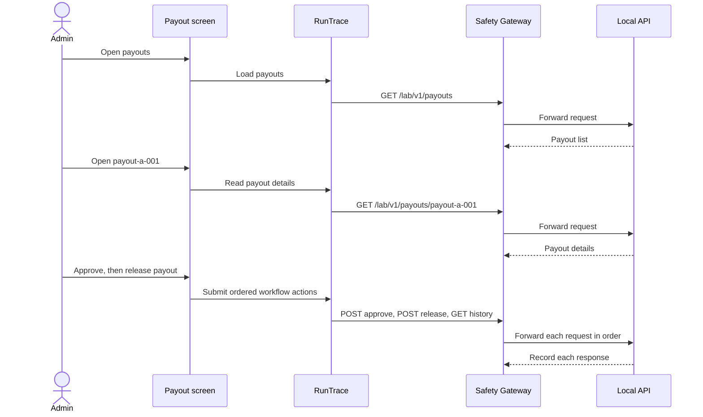

# Custom mock Cyber Range

Use case captures are stored one workflow per file in `traces/usecases/`.
Each file keeps the actor, UI screen/action label, API operation, and object
together for every ordered step. Screen labels describe the interaction the
API mock is standing in for; this repository does not include a browser UI.
There are no expected status/state assertions in these captures. The proxy
records the request and response so the workflow can be inferred from traffic.

For example, payout release follows this interaction order:



Run one use case from `lab-apps/custom/app` after starting the API, MongoDB, and
gateway:

```sh
python runtrace.py \
  --scenario cyber-range/traces/usecases/workflow-invoice-payment.json \
  --allowlist runtrace_allowlist.json \
  --rso cyber-range/model/rso.yaml \
  --evidence /tmp/invoice-payment-capture.json
```

Or select one capture from the suite index:

```sh
python runtrace.py --suite runtrace_traffic_suite.json \
  --scenario-id workflow-payout-release \
  --evidence /tmp/payout-release-capture.json
```

Each state-changing use case should start from a clean seed. The reset endpoint
replaces all collections in the mock seed, including base API data, so reset
only with a disposable database. Do not run mutable sequences concurrently.

Older authorization/state probes are kept separately in `traces/probes/`.
They are exploratory probes and are not the baseline user journeys used to
capture workflow traffic.
